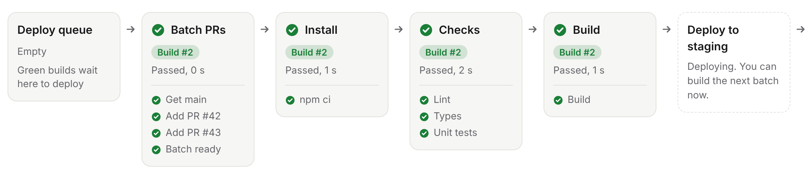
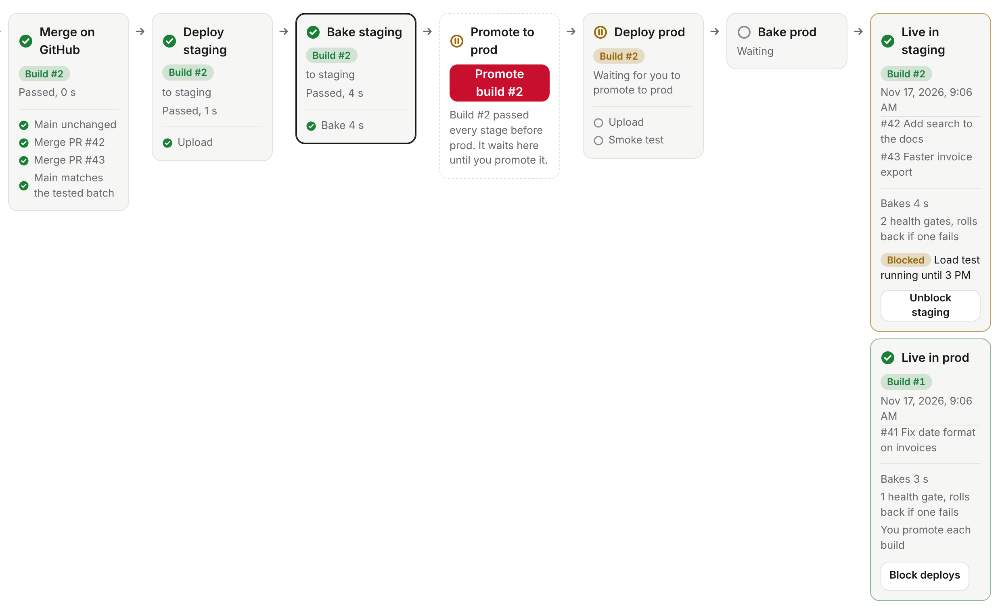
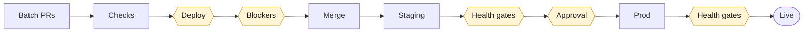

# CI/CD at home

Your own CI/CD pipeline, running on your own machine. No GitHub Actions minutes, no runners to rent.

The aim is an open source CI/CD tool you could run a company on, built the way large release pipelines work:
every change goes out as a numbered build, through test stages and staging before prod, with bake times, health
gates watching your alarms, automatic rollback, and deploy windows.

It is a small web page that does two things:

1. **Build** (one click). It takes your main branch, merges in the open pull requests you tick, and runs your
   checks on the result: lint, tests, build, whatever your repo needs. You watch every stage and step pass or fail.
2. **Deploy** (on its own once a build is green; `"autoDeploy": false` gives you a button instead). It merges those
   pull requests on GitHub, checks that main now has exactly the code that was tested, then runs your deploy steps.

What goes live is always what is on main, and always something that passed your checks.

It works with any GitHub repo. You describe your stages in a small `pipeline.json` file in that repo.

The pipeline page, left to right. Build #2 (PRs #42 and #43) has passed its checks:



It merged, went to staging and passed staging's health gates. Now it waits for a Promote click before prod, while
build #1 stays live in prod. Staging is blocked for a load test, so the next build will wait before it:



## What it does

- **Numbered builds.** Every batch of pull requests is a build (#1, #2, ...). The page shows each one moving left to
  right: queue, build, checks, then each deploy stage.
- **Stacked builds.** Start the next build as soon as the one in front has batched its PRs. It is built on top of
  that one, in its own private copy. Up to 10 builds can be in flight. If one fails its checks, the builds stacked on
  it are marked bad.
- **Deploy queue.** Deploys go one at a time, oldest first. Green builds wait in the queue and ship on their own.
  A failed deploy pauses the queue until you press **Resume queue**.
- **All builds.** Every build, its PRs, when it was built and where it is now. Saved across restarts.
- **Rollback.** "Roll back" on any build that was live rebuilds that build's commit and runs only the deploy stages.
  Main is never rewritten, and the queue pauses until you resume it.
- **Retry a failed stage.** Fix the cause and press **Retry**: the failed deploy stage and the ones after it run
  again, same build, same folder, nothing merged twice. A stage can [skip the steps that already passed](#resuming-a-retried-stage).
- **Survives a restart.** Build numbers, what is live and the last deploy's stage results are saved to disk. A stage
  that was running when the app stopped shows as Stopped and can be retried. Builds still building or queued are lost.
- **One Live card per environment.** Each deploy stage says which environment it makes live (the site to prod, the
  app to TestFlight). Each environment shows the build live there, so a failed app upload never holds back the site.
- **Promotion.** Staging before prod, bake time, health gates (CloudWatch alarms, a health URL, or any command),
  automatic rollback when a gate fails, a **Promote** button, **Block deploys** for a code freeze, and deploy windows.
- **Agents.** Claude Code can read the pipeline, fix a failing PR and build again. Every agent call is logged.

Full detail: [How it works](docs/how-it-works.md).

## The pipeline at a glance

A build moves left to right. This one uses the staging-then-prod setup [below](#staging-bake-time-and-health-gates).



- **Square boxes** run your commands: your build stages (checks), the merge, then each environment's deploy stages.
  **Yellow six-sided boxes** wait or check before the build may go on.
- **Deploy** happens on its own once checks pass, or waits for a click with `"autoDeploy": false`. Green builds queue
  behind the one deploying.
- **Blockers** and **Approval** hold the build at the door of an environment. Each door checks, in order: a block
  someone set on that environment's Live card (with a reason), a **Promote** click when `"autoPromote": false`, then
  the deploy window. Here staging has no Promote step and prod does. The first environment's door comes before the
  merge, so nothing merges into a closed environment.
- **Health gates** wait the bake time and check the alarms, URLs or commands at the start, every 30 seconds and at the end. If a gate says
  the environment is unhealthy, it rolls back to the build that was live there before and the queue pauses.
- **A build that fails its checks** never deploys. **A failed deploy stage** stops the line there and pauses the
  queue until you press **Resume queue**. You can retry it.
- Without `environments`, there are no health gates, Promote clicks or windows, but blocks still hold a build:
  build stages, merge, deploy stages, live.

## Quick start

You need [Node.js 22](https://nodejs.org/), git and the [GitHub CLI](https://cli.github.com/), signed in with
`gh auth login`. There is nothing to install with npm.

```sh
git clone https://github.com/yashkirr/cidc-at-home.git
cd cidc-at-home
./start.sh /path/to/your/repo
```

On a Mac you can double-click `start.command` instead. Your browser opens http://localhost:4321/. Keep the terminal
window open while you use it. Close it to stop.

Then add a `pipeline.json` to your repo (see below), tick the pull requests you want, and press **Build**.

### After you update it

The app reads `server.mjs` and the page once, when it starts. `batch.sh` and `merge.sh` are read fresh by each build.
So after a `git pull`:

1. Wait for any running build or deploy to finish.
2. Stop the app (Ctrl+C, or close its window) and start it again.
3. The open page reloads itself when it sees the new server. If it looks stuck (ticks you can't change), hard-refresh
   it: Cmd+Shift+R on a Mac, Ctrl+Shift+R elsewhere.

A restart forgets builds that were still building or queued, so build them again.

## pipeline.json

Put this at the root of each repo you want to build and deploy:

```json
{
  "branch": "main",
  "environment": "prod",
  "build": [
    { "name": "Install", "run": "npm ci" },
    { "name": "Checks", "run": "npm run lint && npm test" },
    { "name": "Build", "run": "npm run build" }
  ],
  "deploy": [
    { "name": "Upload", "run": "./scripts/deploy.sh", "env": { "TARGET": "prod" } }
  ]
}
```

Each stage is a shell command. It passes when it exits with 0. Any line it prints that starts with `== ` shows up as a
step under the stage, so `echo "== Lint"` gives you a "Lint" step with its own tick.

| Field | Default | What it does |
|---|---|---|
| `branch` | `main` | The branch you release from. |
| `environment` | `prod` | Where deploy stages go, unless a stage names its own. |
| `build` | none | Stages run on each batch, in order. |
| `deploy` | none | Stages run after the merge, in order. |
| `autoDeploy` | `true` | `false`: a **Deploy** button instead of shipping green builds on their own. |
| `environments` | none | Promotion rules per environment (below). |

Each stage has a `name` and a `run` command, and can add `env` (extra variables), `parallel: true` (start beside the
stage before it), and on deploy stages `environment` (the environment it makes live).

### More than one environment

Here the website goes to prod and the iOS app to TestFlight, side by side. Each gets its own Live card, and a failed
app upload doesn't stop the site going live:

```json
{
  "environment": "prod",
  "build": [{ "name": "Checks", "run": "bash scripts/check.sh" }],
  "deploy": [
    { "name": "Website", "run": "bash scripts/release.sh" },
    { "name": "iOS app", "run": "eas build -p ios --auto-submit --no-wait", "parallel": true, "environment": "TestFlight" }
  ]
}
```

### Staging, bake time and health gates

List an environment under `environments` to make it a promotion step. After its stages pass it bakes: the app waits
the bake time and checks its gates at the start, every 30 seconds and at the end. If a gate fails, that environment
rolls back to the build that was live there before and the queue pauses.

```json
{
  "environment": "prod",
  "build": [{ "name": "Checks", "run": "npm ci && npm test" }],
  "deploy": [
    { "name": "Deploy staging", "environment": "staging", "run": "bash scripts/deploy.sh staging" },
    { "name": "Deploy prod", "run": "bash scripts/deploy.sh prod" }
  ],
  "environments": {
    "staging": {
      "bake": "15m",
      "gates": [
        { "alarms": ["staging-5xx", "staging-p99-latency"], "region": "eu-west-1" },
        { "url": "https://staging.example.com/health" }
      ]
    },
    "prod": {
      "bake": "30m",
      "gates": [{ "alarms": ["prod-5xx"] }, { "run": "bash scripts/smoke.sh" }],
      "autoPromote": false,
      "windows": [{ "days": "mon-fri", "from": "09:00", "to": "22:00" }],
      "timezone": "Europe/London"
    }
  }
}
```

| Field | Default | What it does |
|---|---|---|
| `bake` | none | How long to watch after deploying: `"30s"`, `"15m"`, `"2h"` (a plain number is minutes). |
| `gates` | none | Health checks: CloudWatch `alarms` (read with the AWS CLI), a `url` that must answer 2xx/3xx, or a `run` command that must exit 0. |
| `rollback` | `true` | `false`: a failed gate only pauses the queue. |
| `autoPromote` | `true` | `false`: each build waits for a **Promote** click before this environment. |
| `windows` | any time | When builds may go into this environment. |
| `timezone` | your machine's | The time zone for `windows`. |

`branch`, `autoDeploy` and `environments` are read from your own checkout when the app opens the repo, so a pull
request can't loosen them. Restart the app after changing them. You can also **Block deploys** to an environment from
its Live card, with a reason, until you unblock it.

### Resuming a retried stage

Retry runs a failed deploy stage's whole command again. If its first steps can't run twice (say `terraform apply
plan.tfplan` deletes the plan), read these, set only on a retry whose earlier steps passed:

- `CICD_RESUME_FROM`: the name of the first step that did not pass, as printed after `== ` (empty if it failed
  after its last step).
- `CICD_PASSED_STEPS`: the steps that passed before it, one per line.

Skip the passed steps, so the stage starts at `CICD_RESUME_FROM`. The page shows them as "skipped (passed earlier)". The retry runs in
the same folder, so files they made are still there; shell variables are not, so write what a later step needs to a
file. Exit as soon as a step fails, or the next retry counts it as passed. A stage that ignores the variables runs
every step again, as before.

```sh
passed() { grep -qxF "$1" <<< "$CICD_PASSED_STEPS"; }
passed Apply || { echo "== Apply"; terraform apply plan.tfplan && rm plan.tfplan || exit 1; }
echo "== Smoke test"; ./smoke.sh
```

Full reference: [docs/pipeline-json.md](docs/pipeline-json.md). Ready-made setups: [examples/](examples/).

## Let Claude fix failures

Claude Code can read the pipeline and act on it, so you don't copy logs into the chat. Add it once:

```sh
claude mcp add cicd -- node /path/to/cidc-at-home/mcp.mjs
```

Then, in Claude Code in your app's repo, say "the batch failed, fix it". Claude sees which PRs clash or which check
failed, reads the log, fixes the PR branch, pushes, and builds again. Its tools: `pipeline_status`, `build_log`,
`build`, `retry_stage` and `resume_queue`. A build it starts deploys on its own once green, like any build (unless
pipeline.json sets `"autoDeploy": false`). It can't roll back, stop or change the queue: those stay a click on the page.

`list_repos` names the repos the app knows, and every other tool takes an optional `repo` (one of those names), so
Claude can act on any of them from one session. Naming a repo that isn't open opens it, and the page follows. That
happens only while the open repo has nothing running or queued. Otherwise the call is refused, so a switch never drops
a build or deploy in progress. Adding a new repo stays a click on the page.

Every call an agent makes, reads and refused ones too, is logged with the agent's name, the action, its arguments,
the time and the result in `~/.cicd-at-home/agent-log.jsonl`. The page shows them under Agent activity, and builds an
agent started are marked "by" it in All builds.

## Docs

- [Getting started](docs/getting-started.md): install, first run, adding repos.
- [pipeline.json reference](docs/pipeline-json.md): every field, steps, environment variables.
- [How it works](docs/how-it-works.md): the batch, the private copy, the merge check, what each button does.
- [Moving off GitHub Actions](docs/moving-off-github-actions.md): turning workflow files into stages.
- [Running it on a server](docs/server.md): use it on a VPS, safely.
- [Security](docs/security.md): what it protects against and what it trusts.
- [Troubleshooting](docs/troubleshooting.md): common errors and what to do.

## What it is not

- It does not run on every push by itself. You press Build when you want a build. That is the point: no minutes are
  spent unless you choose to.
- It does not post check results to GitHub pull requests. The page is where you see them.
- It runs one pipeline at a time.

## Tests

```sh
npm test
```

The test builds and deploys a throwaway repo against a fake GitHub, so it needs no network and touches nothing real.
