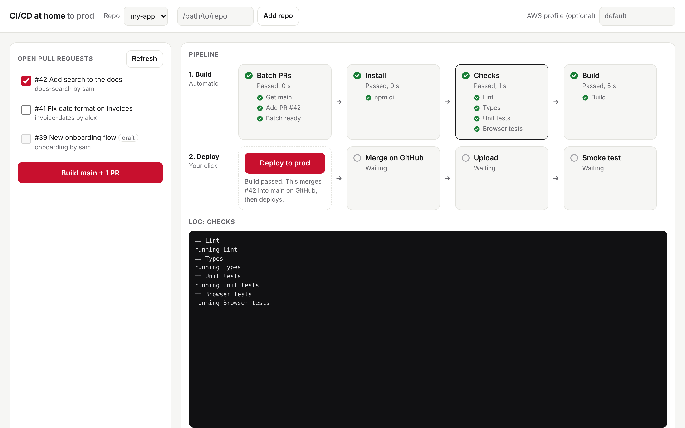

# CI/CD at home

Your own CI/CD pipeline, running on your own machine. No GitHub Actions minutes, no runners to rent.

It is a small web page that does two things:

1. **Build** (one click). It takes your main branch, merges in the open pull requests you tick, and runs your
   checks on the result: lint, tests, build, whatever your repo needs. You watch every stage and step pass or fail.
2. **Deploy** (one click, only after a green build). It merges those pull requests on GitHub, checks that main now
   has exactly the code that was tested, then runs your deploy steps. While it deploys, you can already build the
   next batch, stacked on the one going out, so it is ready to deploy the moment this one finishes.

What goes live is always what is on main, and always something that passed your checks.

It works with any GitHub repo. You describe your stages in a small `pipeline.json` file in that repo.



## Quick start

You need [Node.js 22](https://nodejs.org/), git and the [GitHub CLI](https://cli.github.com/), signed in with
`gh auth login`. There is nothing to install with npm.

```sh
git clone https://github.com/yashkirr/cidc-at-home.git
cd cidc-at-home
./start.sh /path/to/your/repo
```

On a Mac you can double-click `start.command` instead. Your browser opens http://localhost:4321/. Keep the terminal
window open while you use it. Close it to stop.

Then add a `pipeline.json` to your repo (see below), tick the pull requests you want, and press **Build**.

## pipeline.json

Put this at the root of each repo you want to build and deploy:

```json
{
  "branch": "main",
  "environment": "prod",
  "build": [
    { "name": "Install", "run": "npm ci" },
    { "name": "Checks", "run": "npm run lint && npm test" },
    { "name": "Build", "run": "npm run build" }
  ],
  "deploy": [
    { "name": "Upload", "run": "./scripts/deploy.sh", "env": { "TARGET": "prod" } }
  ]
}
```

Each stage is a shell command. It passes when it exits with 0. Any line it prints that starts with `== ` shows up as a
step under the stage, so `echo "== Lint"` gives you a "Lint" step with its own tick.

Full reference: [docs/pipeline-json.md](docs/pipeline-json.md). Ready-made setups: [examples/](examples/).

## Let Claude fix failures

Claude Code can read the pipeline and act on it, so you don't copy logs into the chat. Add it once:

```sh
claude mcp add cicd -- node /path/to/cidc-at-home/mcp.mjs
```

Then, in Claude Code in your app's repo, say "the batch failed, fix it". Claude sees which PRs clash or which check
failed, reads the log, fixes the PR branch, pushes, and builds again. Its tools: `pipeline_status`, `build_log`,
`build`, `retry_stage` and `resume_queue`. It can't deploy or roll back: those stay a click on the page.

Every call an agent makes, reads and refused ones too, is logged with the agent's name, the action, its arguments,
the time and the result in `~/.cicd-at-home/agent-log.jsonl`. The page shows them under Agent activity, and builds an
agent started are marked "by" it in All builds.

## Docs

- [Getting started](docs/getting-started.md): install, first run, adding repos.
- [pipeline.json reference](docs/pipeline-json.md): every field, steps, environment variables.
- [How it works](docs/how-it-works.md): the batch, the private copy, the merge check, what each button does.
- [Moving off GitHub Actions](docs/moving-off-github-actions.md): turning workflow files into stages.
- [Running it on a server](docs/server.md): use it on a VPS, safely.
- [Security](docs/security.md): what it protects against and what it trusts.
- [Troubleshooting](docs/troubleshooting.md): common errors and what to do.

## What it is not

- It does not run on every push by itself. You press Build when you want a build. That is the point: no minutes are
  spent unless you choose to.
- It does not post check results to GitHub pull requests. The page is where you see them.
- It runs one pipeline at a time.

## Tests

```sh
npm test
```

The test builds and deploys a throwaway repo against a fake GitHub, so it needs no network and touches nothing real.
